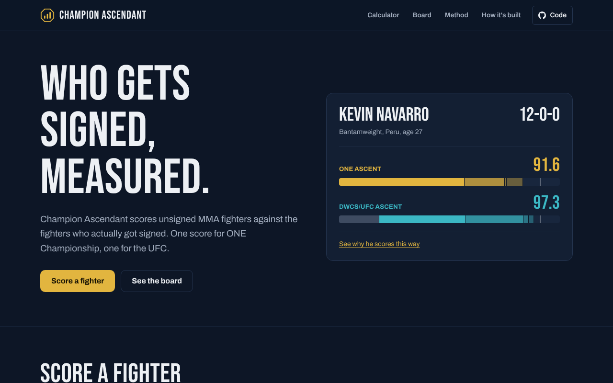
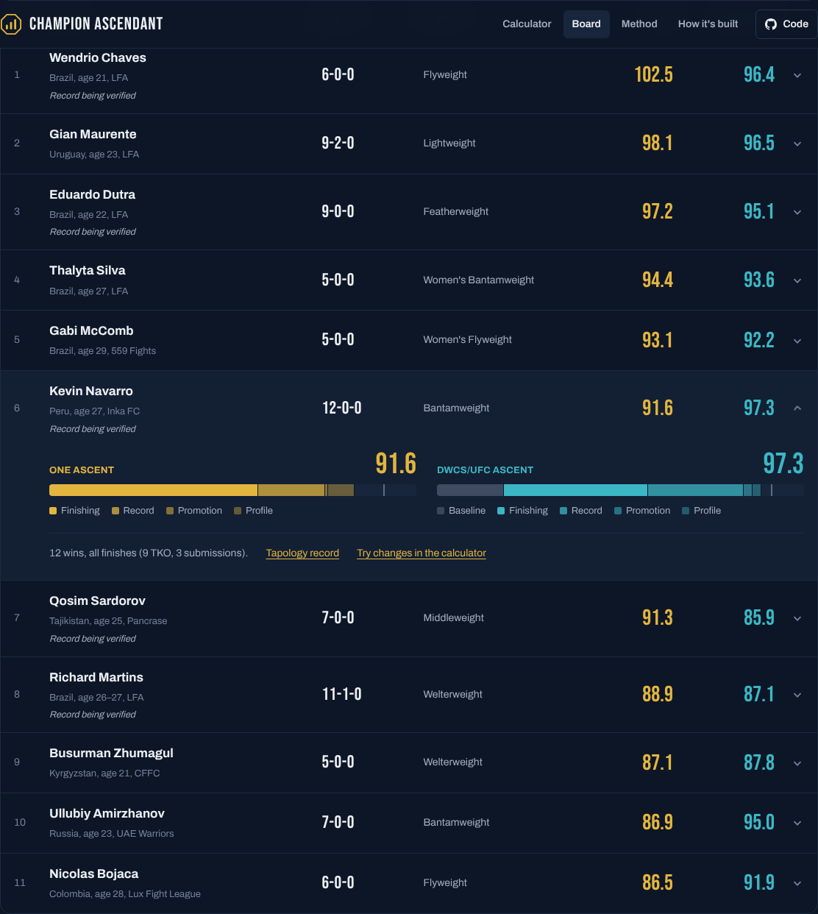

# Champion Ascendant

[](https://github.com/Dethrone1/champion-ascendant-demo/actions/workflows/tests.yml)

**Live site:** [championascendant.com](https://championascendant.com)

Scores unsigned MMA fighters against the fighters who actually got signed. Two separate scores, never combined:

- **ONE ASCENT**, built from ONE Championship's signings
- **DWCS/UFC ASCENT**, built from the fighters the UFC brings in through the Contender Series



## How it works

```
Records (Tapology, then Sherdog)
  -> Python scoring (private)
  -> Flask API: /api/score, /api/board, /api/options
  -> HTML, CSS and JavaScript pages, deployed on Railway
```

Scoring runs only on the server, so the formulas never reach the browser. Pages get a score and a breakdown by broad group (finishing, record, promotion, profile, titles).

**This repo ships stand-in formulas** (`scoring/sample_formulas.py`) with the same interface as the private ones, so everything runs, but its scores are not the published ones.



## Tests

```
pip install -r requirements.txt pytest
pytest tests
```

- **Board:** every published score is recomputed from its inputs (runs where the private formulas are present)
- **API:** bad input is rejected with a clear message; responses never expose formula data
- **Pages:** every page loads, no stray code or version labels on the page, page scripts parse, formula files are never served

GitHub Actions runs them on every push and pull request.

## Run locally

```
pip install -r requirements.txt
python app.py
```

Then open http://localhost:5000

## Stack

Python, Flask, JavaScript, HTML and CSS, pytest, GitHub Actions, Railway. Data work in Excel and pandas.

## Credits

Conceived and directed by me, built using AI tools.
