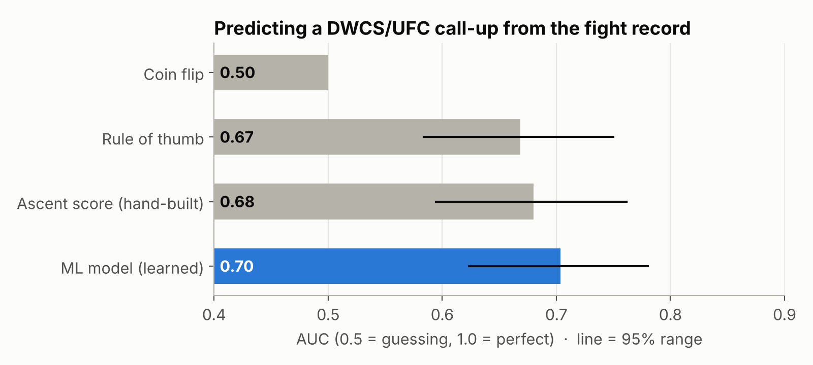
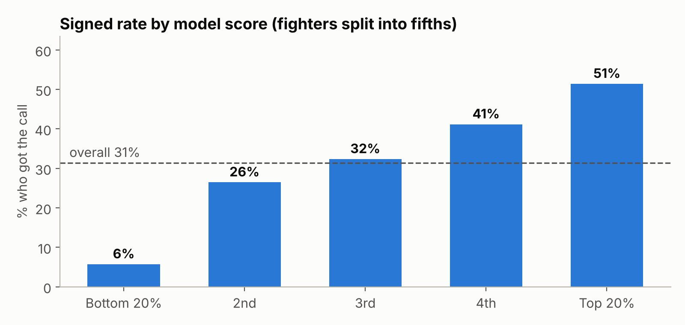
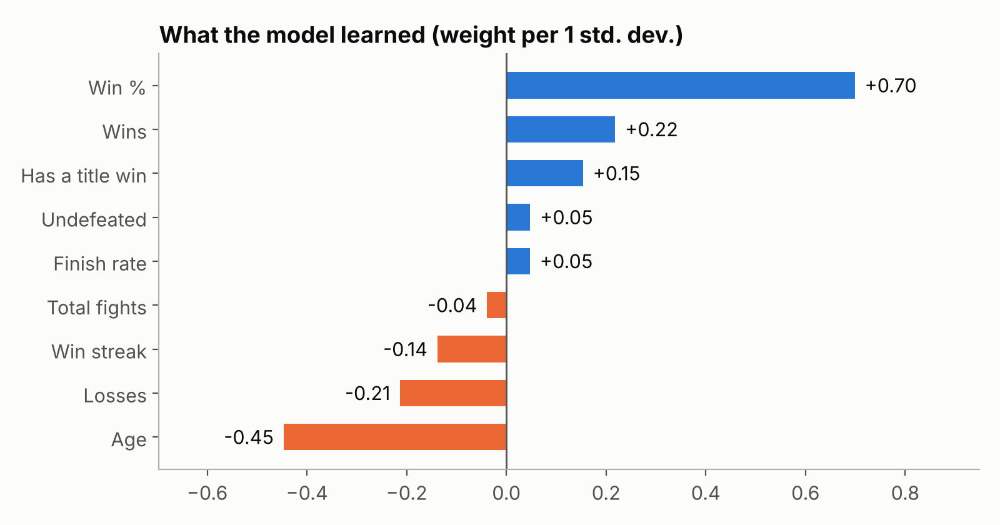
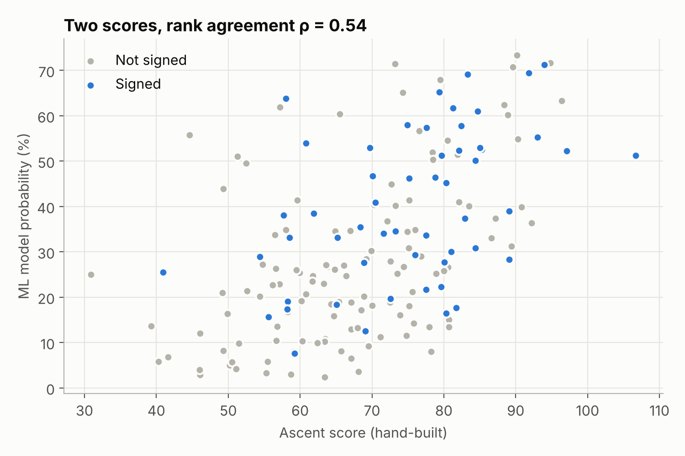
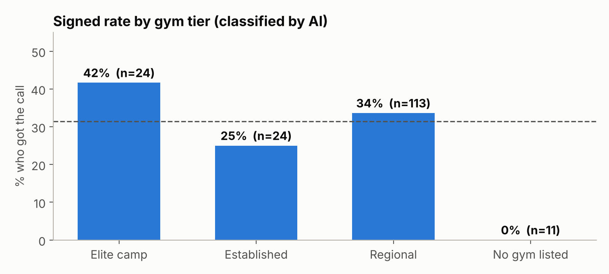

# Predicting the UFC call from the fight record

I wanted to know how much a regional fighter's record actually tells you about whether the UFC calls. So I took 172 headliners from 2024–25, checked every record fight by fight, and trained a model on who got signed.

**Short answer:** fighters the model rated highest got the call 51% of the time. The lowest-rated got it 6% of the time. Overall it scores 0.70 AUC, a bit better than a simple rule of thumb and my own hand-built score, but the record only gets you so far.



## Data
- **172 fighters** who headlined LFA, Cage Warriors, Fury FC, UAE Warriors, Brave CF and OKTAGON cards in 2024–25. **54 (31%)** later showed up on the Contender Series, in the UFC, on TUF or on Road to UFC (through 31 Oct 2026).
- **Records checked by hand.** I counted every fighter's full Sherdog fight list in code and settled disagreements with Tapology and promotion sites. That caught a cancelled fight, a few fighters whose listed bout was actually amateur, and two records missing 4 and 8 wins.
- **No peeking.** Stats are as of the fight before their listed bout, so nothing from later leaks in.
- Data: [`dwcs_prospects_172.csv`](dwcs_prospects_172.csv)

## Results
| Approach | AUC | 95% range |
|---|---|---|
| Coin flip | 0.50 | — |
| Rule of thumb (undefeated, 27 or under, finishes 60%+ of wins) | 0.67 | 0.58–0.75 |
| My hand-built DWCS/UFC Ascent score | 0.68 | 0.60–0.76 |
| **Logistic regression** | **0.70** | 0.62–0.78 |

AUC = how often a signed fighter ranks above an unsigned one. Every fighter was scored by a version of the model trained without them (5-fold cross-validation, repeated 20 times). The ranges overlap, so the model's edge is small and not proven yet.



### What the model weights
Win % and age matter most. Finish rate barely moves it once win % is in. A long win streak actually counts a little against a fighter, probably because long streaks often come against weaker regional opponents.



### Model vs. my hand-built score
They only partly agree (rank correlation 0.54, 15 of their top 30 are the same), but both get 15–16 signees in their top 30, against about 9 by chance. Where they disagree, my score likes veterans with lots of finishes (think 18-9 knockout artists) and the model likes young fighters with few losses. Neither side clearly wins those cases here, so combining the two is worth trying.



### Does the gym matter?
A record doesn't show where someone trains, so I sorted every fighter's gym (from Sherdog) into elite camp (American Top Team, Kill Cliff, Xtreme Couture and so on), established team or regional gym. The sorting was done with Claude against a fixed set of criteria; see [`extract_gym_tier.py`](extract_gym_tier.py).



| Model | AUC |
|---|---|
| Record only | 0.70 |
| Record + elite gym | 0.70 |

Not really. Elite-camp fighters got signed a bit more (42% vs 34%), but once the record is in the model, the gym adds nothing. My guess is elite camps mostly take on fighters who already have good records.

Fighters with no gym listed went 0 for 11, which looks like a great signal. It isn't. Profiles usually get filled in after someone signs, so a blank profile partly reflects the outcome. I left it out.

## Limits
- 172 is a small sample, so treat every number here as a range.
- Fighters from late 2025 have had less time to get the call than 2024 fighters, so a few "not signed" will change.
- Opponent quality, management and what divisions the UFC needs all matter too. None of that is in the model yet.
- Gym is the fighter's current one, not where they trained at the time.
- My Ascent score was partly tuned on Contender Series rosters that overlap with some fighters here, and it uses promotion tier, which the model doesn't. Its formula isn't published.

## Next
Add opponent quality (the records of the fighters each prospect beat), and test it the way it would really be used: train on 2024, predict 2025.

## Run it
```
pip install -r requirements.txt
jupyter notebook dwcs_ascent_ml.ipynb   # full analysis and charts
python retrain.py                       # retrain in one command
```

## Keeping it current
The model doesn't update on its own. When new results come in:
1. After each Contender Series season, re-check the "not signed" fighters and flip anyone who got the call (0 → 1).
2. Add new fighters, with stats as of their listed bout.
3. Run `python retrain.py`. Each run is logged in [`retrain_log.csv`](retrain_log.csv). If accuracy drops by more than 0.02, the new model isn't saved, so bad data can't quietly make it worse.

Part of [Champion Ascendant](https://championascendant.com).
